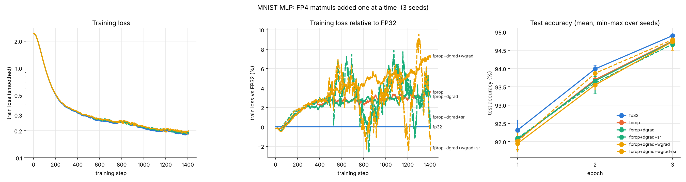
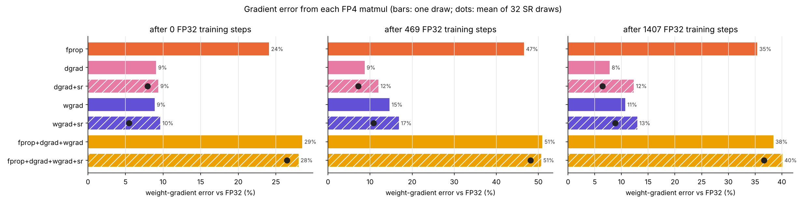

# needle-fp4

4-bit floating point (NVFP4) training and inference inside **needle**, the deep
learning framework we built in CMU 10-414/714 (Deep Learning Systems).
Everything is implemented in needle itself. There is no PyTorch, TensorFlow, or
JAX in project code; NumPy is used only for the reference quantizer and tests.

## Questions we are answering

1. **Research:** a linear layer runs three matmuls during training:
   Fprop `Y = X W`, Dgrad `dX = dY Wᵀ`, and Wgrad `dW = Xᵀ dY`.
   When each one runs in FP4, which one breaks training, and does stochastic
   rounding fix it?
2. **Systems:** how much memory and matrix-vector (GEMV) time does 4-bit weight
   storage save during generation?

## Status

| Stage | What | Status |
|---|---|---|
| 0 | Read the homework code, plan the changes | done |
| 1 | NumPy reference quantizer (`python/needle/fp4/reference.py`) + tests | done |
| 2 | Fake-quant FP4 linear Op and `nn.QuantizedLinear` | done (CPU); CUDA tests run on Colab |
| 3 | MNIST MLP experiments (FP32 / Fprop / +Dgrad / +Wgrad, with and without SR) | done on CPU (below); GPU runs via the notebook |
| 4 | CUDA quantize+pack and FP4 GEMV kernels, 4096x4096 benchmark | not started |

## NVFP4 in one paragraph

Each element is FP4 E2M1 (1 sign, 2 exponent, 1 mantissa bit), so it can only
be one of `{0, 0.5, 1, 1.5, 2, 3, 4, 6}` with a sign. Values are grouped into
blocks of 16 along the matmul's reduction axis. Every block has a scale stored
in FP8 E4M3, and the whole tensor has one FP32 scale:

```
tensor_scale = amax(tensor) / (6 * 448)
block_scale  = round_to_e4m3((amax(block) / 6) / tensor_scale)
value        = e2m1(code) * block_scale * tensor_scale
```

Two 4-bit codes are packed per byte (element `2i` in the low nibble). Our
rounding conventions (ties to even, stochastic rounding only on elements, zero
always encoded as `+0`) are documented at the top of
[`python/needle/fp4/reference.py`](python/needle/fp4/reference.py).

## Repository layout

```
python/needle/          needle from our homeworks (hw0 to hw4 + transformer)
python/needle/fp4/      FP4 code: NumPy reference, NDArray fake quantization, QuantConfig
python/needle/ops/ops_fp4.py   FP4Matmul Op (each training matmul can run in FP4)
python/needle/nn/nn_fp4.py     nn.QuantizedLinear (drop-in for nn.Linear)
src/                    C++ (CPU) and CUDA backends, exposed with pybind11
apps/                   homework models, plus fp4_experiment.py and plot_fp4.py
notebooks/              fp4_experiments.ipynb: tests + experiments on a Colab GPU
docs/results/           plots and summary tables from our runs
tests/hw4, hw4_extra/   course tests (need PyTorch and mugrade, see below)
tests/fp4/              our FP4 tests (NumPy and pytest only)
```

## Running on Google Colab

```python
from google.colab import drive
drive.mount('/content/drive')
%cd /content/drive/MyDrive/10714
!git clone https://github.com/shreya-v7/fp4-needle.git
%cd fp4-needle
!pip3 install pybind11
!make
%set_env PYTHONPATH ./python
%set_env NEEDLE_BACKEND nd
!python3 -m pytest tests/fp4 -v
```

Pick a GPU runtime (Runtime > Change runtime type) so `make` also builds the
CUDA backend. To try someone's branch: `!git fetch && git checkout dev/<name>-<topic>`.

The course tests in `tests/hw4` and `tests/hw4_extra` compare against PyTorch
(already installed on Colab) and import `mugrade`:
`!pip3 install --upgrade --no-deps git+https://github.com/dlsys10714/mugrade.git`.
They also need the datasets in `data/` (not tracked in git). MNIST is in our
Drive folder under `hw2/data`, so `!mkdir -p data && cp ../hw2/data/*.gz data/`.

## Running the experiments

The easiest way is `notebooks/fp4_experiments.ipynb` on Colab with a GPU runtime: it
builds needle, runs the tests (including CUDA), and trains every configuration.
From a terminal in the repo root:

```bash
python3 apps/fp4_experiment.py --configs all --device cuda --epochs 3 --seed 0 --out results/mnist_seed0.csv
python3 apps/plot_fp4.py results/mnist_seed*.csv --out-dir results
```

`--configs grid` is the project grid (FP32, Fprop, Fprop+Dgrad, Fprop+Dgrad+Wgrad,
with SR where it matters), `--configs ablation` puts one backward matmul in FP4 at a
time, and `--configs all` runs both, and `--only NAME ...` reruns selected configs.
`apps/fp4_grad_error.py` measures each FP4 matmul's gradient error against FP32. Stochastic rounding applies to the gradient
operand dY only, so "FP32 + SR" and "Fprop + SR" would equal their SR-off runs and
are not trained twice.

## Results so far (CPU, MNIST)

784-256-256-10 MLP, every linear layer an `nn.QuantizedLinear`, 3 epochs, batch 128.
SGD is our homework optimizer (lr 0.05, momentum 0.9) with 3 seeds; Adam (lr 1e-3) has 1 seed.
Full tables: [`docs/results/cpu_sgd/summary.md`](docs/results/cpu_sgd/summary.md),
[`docs/results/cpu_adam/summary.md`](docs/results/cpu_adam/summary.md).

| config | SGD test acc (%) | SGD train loss | Adam test acc (%) | Adam train loss |
|---|---|---|---|---|
| FP32 | 94.90 ± 0.04 | 0.183 | 97.52 | 0.061 |
| Fprop | 94.75 ± 0.04 | 0.190 | 97.36 | 0.068 |
| Fprop + Dgrad | 94.74 ± 0.04 | 0.190 | 97.49 | 0.065 |
| Fprop + Dgrad + SR | 94.67 ± 0.05 | 0.188 | 97.57 | 0.060 |
| Fprop + Dgrad + Wgrad | 94.74 ± 0.18 | **0.197** | 97.43 | **0.071** |
| Fprop + Dgrad + Wgrad + SR | 94.79 ± 0.09 | 0.181 | 97.66 | 0.056 |

(train loss = mean of the last 100 steps; SR = stochastic rounding of the gradient dY)

What we see:

* **Nothing breaks on this model.** Every configuration ends within about 0.3 points of
  FP32 test accuracy. A small MLP trained for 3 epochs is a forgiving setting.
* **Fprop is the most expensive single matmul here:** about 3% higher training loss for
  the whole run, and the largest change in the gradients (24 to 47% relative difference
  in `docs/results/cpu_sgd/grad_error.png`), because it changes the function being trained.
* **Wgrad with round-to-nearest is where gradients get damaged:** once gradients shrink
  during training, 3 to 4.5% of weight-gradient entries round to exactly zero (FP4
  underflow), and all-FP4 round-to-nearest has the highest training loss with both
  optimizers.
* **Stochastic rounding fixes it:** with SR, all-FP4 training loss is back at (or below)
  FP32. In the gradient-error experiment a single SR gradient is noisier than
  round-to-nearest, but the average of 32 SR gradients is closer to FP32, i.e. SR trades
  bias for noise. It does not remove all bias, because X and W are still rounded to nearest.

Next: the LSTM language model, where longer training and recurrent gradients should
stress FP4 more than MNIST does.




## Contributing

* **Never push to `main`.** All changes reach `main` through a pull request.
* **Branch names must be `dev/<firstname>-<topic>`**, lowercase, for example
  `dev/shreya-stage2-fake-quant`. CI rejects pull requests from any other branch name.
* CI builds the CPU backend and runs `tests/fp4` on every pull request; it
  must pass before merging.
* Keep pull requests small (one stage or one piece of a stage) and say in the
  description how you tested it.

## Known issues inherited from the homework code

These are left as they were in our homework submissions:

* `NDArray.__getitem__` with a negative slice start (`a[-2:]`) raises an
  `AssertionError`: `process_slice` sets `start = shape[dim]` instead of
  `shape[dim] + start`.
* `apps/simple_ml.py` `nn_epoch` computes `ReLU(X * W1) * W1`; the second
  factor should be `W2`. We do not use this function.
* The CUDA matmul uses 4x4 tiles (16 threads per block): correct but slow.
